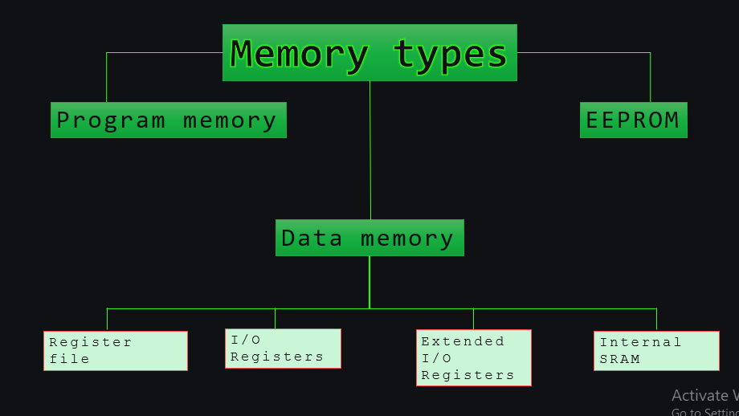
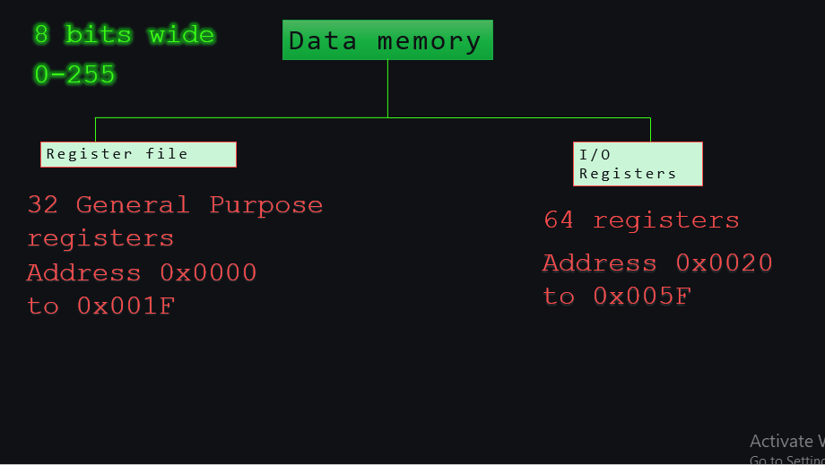
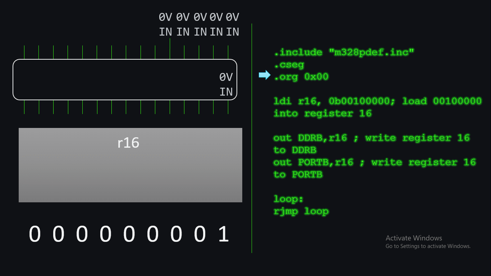
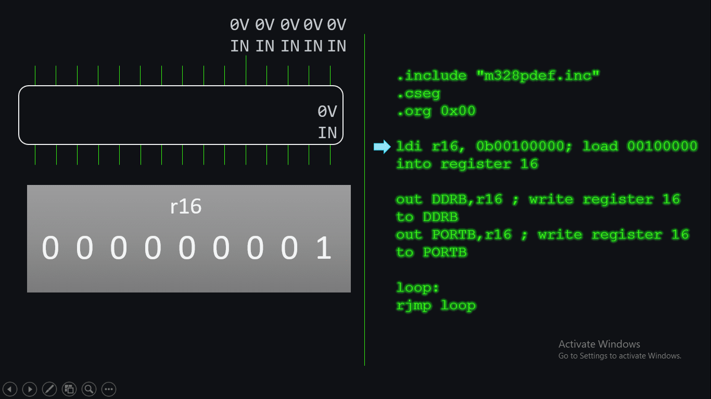
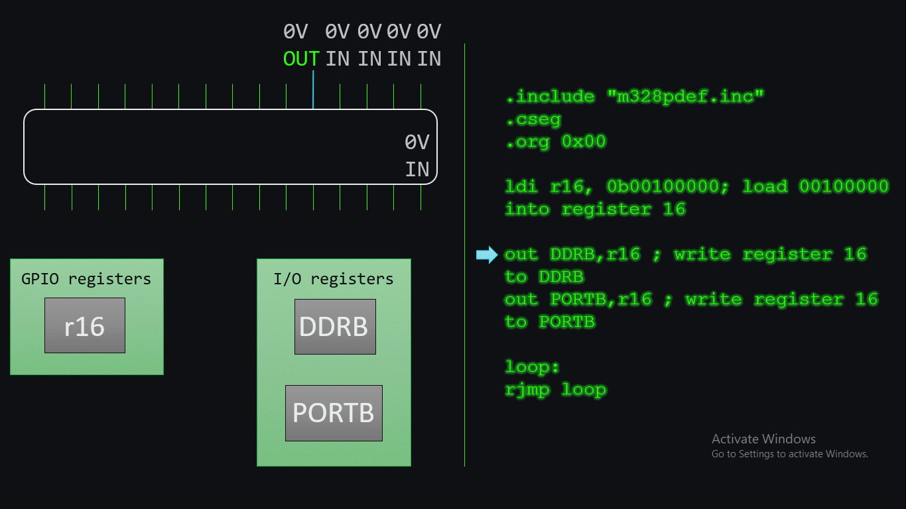

# 🛠️ How AVR Microcontroller Registers Work (Line-by-Line)

When you write basic Arduino code to turn on an LED, it hides a lot of binary overhead (~1 KB to 2 KB). By using **AVR Assembly Language**, we can achieve the exact same result in just **59 bytes** of binary!

Here is exactly what happens inside the **ATmega328P microcontroller** registers line-by-line. But before that you need a breif understanding of AVR memory types and their uses.

---

## The Code

```assembly
.include "m328pdef.inc" 
.cseg 
.org 0x00 

ldi r16, 0b00100000   ; Line 1: Load data into register
out DDRB, r16         ; Line 2: Set pin direction
out PORTB, r16        ; Line 3: Turn pin HIGH

loop: 
    rjmp loop         ; Line 4: Infinite loop
```

---

## 🧠 Microcontroller Memory Architecture

* **Program Memory (Flash):** Program Memory, also referred to as flash, is where your code is stored. Depending on settings in the fuse bits, the entire flash memory can be used as application storage or a portion can be code-blocked off for a bootloader program. Flash memory is non-volatile meaning its data does not go away when the microcontroller loses power. Flash cannot be accessed as quickly as Data Memory and individual bytes cannot be modified at a time so it is not a good place to store variables which constantly change. However, in addition to storing your application code, it is a good place to put constants like lookup tables or strings.
* **Data Memory:** Data Memory is composed of four parts:
    -Register File
    -I/O Registers
    -Extended I/O Registers
    -Internal SRAM
Unlike flash, Data Memory is not composed of a single memory type. Rather, it is a contiguous mapping of addresses across multiple memory types.



For now we will focus on two main parts Register File and I/O Registers:-

The register file begins at the start of Data Memory and contains 32 general purpose working registers that are directly connected to the arithmetic logic unit (ALU). The general purpose working registers are used as operands for most instructions.

The I/O Registers are locations in Data Memory which control certain microcontroller functions. All of the data direction registers and ports (e.g. DDRB and PORTB) are located in the I/O Register portion of Data Memory. Because they are needed so often, there are special instructions which allow quick access and modification of the I/O Registers.
The I/O Registers are non-volatile. They will initialize to default values that may or may not need to be changed by your program.



> *Credit: RJH Coding Tutorials*

---

## 🔍 Line-by-Line Execution Breakdown

### 1. `ldi r16, 0b00100000`
* **Command:** `ldi` (Load Immediate).
* **What it does:** Loads the raw binary number `00100000` directly into a temporary workspace called **Register 16 (r16)**.
* **Hardware State:** 
  * `r16` = `00100000`
  * This specific binary configuration targets the **5th bit (b5)**, which corresponds to Digital Pin 13 on an Arduino Uno.




### 2. `out DDRB, r16`
* **Command:** `out` (Output to I/O Register).
* **What it does:** Copies the contents of `r16` into **DDRB** (Data Direction Register for Port B). 
* **Hardware State:** 
  * Setting a bit to `1` in the direction register configures that specific pin as an **Output**. 
  * Pin 13 is now officially set to output mode.



### 3. `out PORTB, r16`
* **Command:** `out` (Output to I/O Register).
* **What it does:** Copies the contents of `r16` into **PORTB** (Output Register for Port B).
* **Hardware State:** 
  * The voltage at Pin 13 shifts directly from **0V (LOW) to 5V (HIGH)**.
  * If an LED is connected to Pin 13, it turns on right at this moment!



### 4. `loop: rjmp loop`
* **Command:** `rjmp` (Relative Jump).
* **What it does:** Tells the program counter to jump backwards to the label named `loop`.
* **Hardware State:** 
  * Creates an infinite loop. This keeps the microcontroller running safely in place so it doesn't try to execute empty space in the program memory.

---

## 📝 Quick Reference for Beginners

* **DDRx (Direction Register):** Sets whether a pin is an Input (`0`) or an Output (`1`).
* **PORTx (Output Register):** Sets the physical voltage level. Writing `0` outputs `0V`, writing `1` outputs `5V`.
* **PINx (Input Register):** Reads the incoming external voltage level from the physical pin.

